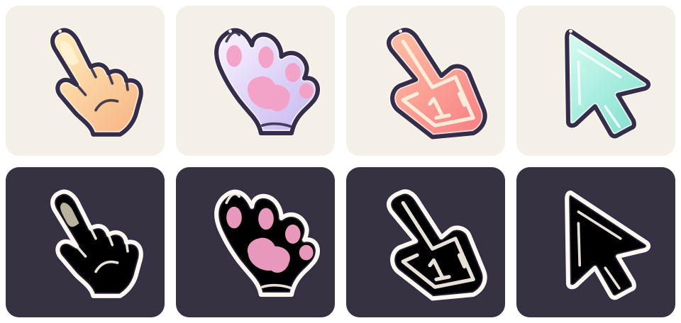

<h1 align="center">Pokelet</h1>

<strong>A little personality for your Mac cursor.</strong>

A free, lightweight, open-source animated cursor companion for macOS.

  <a href="https://github.com/smcnab1/pokelet/releases/tag/v1.2.0-beta.1"><strong>Download</strong></a> ·
  <a href="https://github.com/smcnab1/pokelet/wiki">Documentation</a> ·
  <a href="https://github.com/smcnab1/pokelet/discussions">Discussions</a> ·
  <a href="https://smcnab1.github.io/pokelet/">Website</a> ·
  <a href="https://github.com/smcnab1/pokelet/issues/new/choose">Report an issue</a>

  <a href="https://github.com/smcnab1/pokelet/releases">
    <picture>
      <source media="(prefers-color-scheme: dark)"
        srcset="https://shieldcn.dev/github/tag/smcnab1/pokelet.svg?variant=ghost&amp;font=geist-mono&amp;label=VERSION&amp;mode=dark">
      
    </picture>
  </a>
  <a href="https://github.com/smcnab1/pokelet/actions/workflows/macos.yml">
    <picture>
      <source media="(prefers-color-scheme: dark)" srcset="https://shieldcn.dev/github/ci/smcnab1/pokelet.svg?workflow=macos.yml&amp;branch=main&amp;variant=ghost&amp;font=geist-mono&amp;label=BUILD&amp;mode=dark">
      
    </picture>
  </a>
  <a href="LICENSE">
    <picture>
      <source media="(prefers-color-scheme: dark)" srcset="https://shieldcn.dev/github/license/smcnab1/pokelet.svg?variant=ghost&amp;font=geist-mono&amp;label=LICENSE&amp;mode=dark">
      
    </picture>
  </a>
  <a href="https://scorecard.dev/viewer/?uri=github.com/smcnab1/pokelet">
    <picture>
      <source media="(prefers-color-scheme: dark)" srcset="https://shieldcn.dev/github/scorecard/smcnab1/pokelet.svg?variant=ghost&amp;font=geist-mono&amp;label=SCORECARD&amp;mode=dark">
      
    </picture>
  </a>
  <a href="https://www.bestpractices.dev/projects/16999">
    <picture>
      <source media="(prefers-color-scheme: dark)" srcset="https://shieldcn.dev/badge/dynamic/json.svg?url=https%3A%2F%2Fwww.bestpractices.dev%2Fprojects%2F16999%2Fbadge.json&amp;query=%24.badge_level&amp;label=OPENSSF&amp;variant=ghost&amp;font=geist-mono&amp;logo=lu:ShieldCheck&amp;mode=dark">
      
    </picture>
  </a>

  
  

## Make it yours

- Pick one of four original cartoon characters and customise its colour and size.
- Try Companion, Click-only and Presenter Arm in [Pokelet Studio](docs/STUDIO.md). Adjust click effects and add an optional sound.
- Everything runs locally. Pokelet has no accounts, telemetry or background updater.

## Install

[Get Pokelet 1.2.0 Beta 2](https://github.com/smcnab1/pokelet/releases/tag/v1.2.0-beta.1), open the DMG and drag Pokelet to Applications. The current beta is **ad hoc signed and unnotarised**. Follow the [verification and first-launch guide](docs/VERIFYING_RELEASES.md) before opening it.

**macOS 14 or later** · Universal build for Apple silicon and Intel. [Compatibility and testing coverage](docs/README.md#compatibility)

## Documentation

[Installation and usage](docs/README.md) · [Privacy and permissions](PRIVACY.md) · [Security](SECURITY.md) · [Contributing](CONTRIBUTING.md) · [Licence](LICENSE) · [Acknowledgements](THIRD_PARTY_NOTICES.md)
