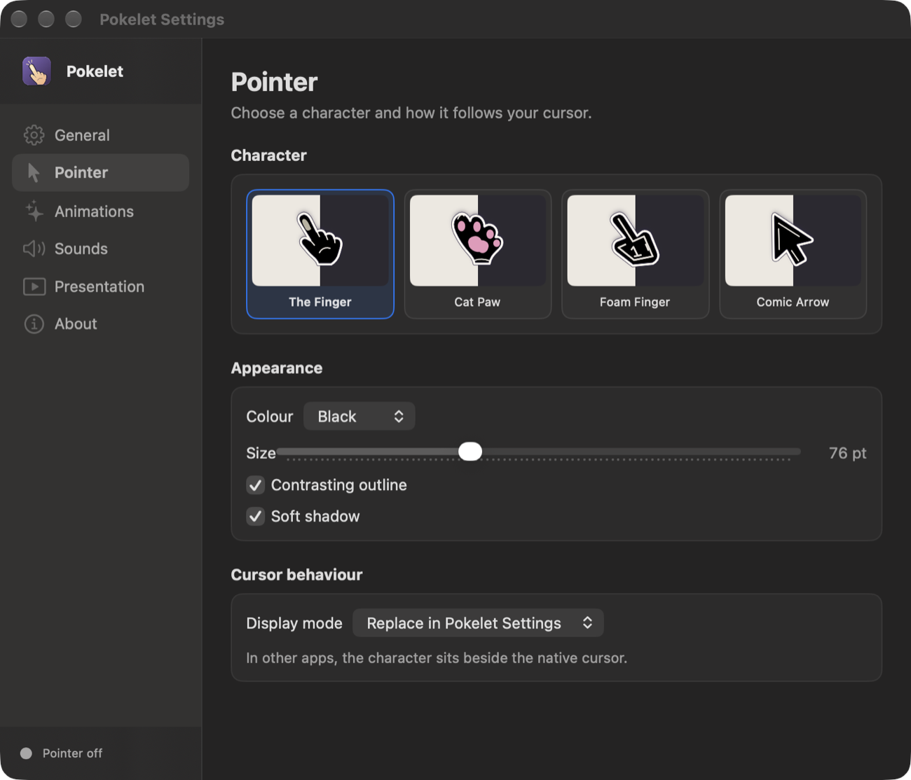
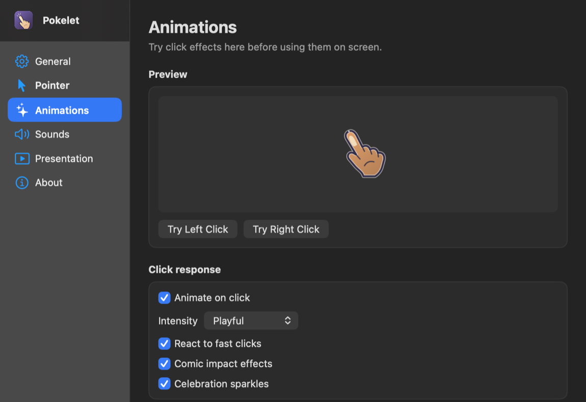

# Pokelet

A free, open-source animated cursor for macOS. Pick a cartoon pointing hand, a cat paw, a foam finger or a comic arrow. Each click makes the character poke.

**macOS 14 or later · Universal build for Apple silicon and Intel**

[Download the beta DMG](https://github.com/smcnab1/pokelet/releases/download/v1.1.0-beta.1/Pokelet-1.1.0-unnotarised.dmg) · [Release notes and checksum](https://github.com/smcnab1/pokelet/releases/tag/v1.1.0-beta.1) · [Project website](https://smcnab1.github.io/pokelet/) · [Report an issue](https://github.com/smcnab1/pokelet/issues/new/choose)

**Beta download.** The app is ad hoc signed and has not been notarised by Apple. macOS may block it on first launch.


<details>
<summary>Watch the click animation</summary>


</details>

## Get Pokelet

1. Download and open the DMG. Drag **Pokelet** into **Applications**, then eject the disk image.
2. Open Pokelet from **Applications**. If macOS blocks it because Apple cannot verify the developer, proceed only if you trust the source and the [published checksum](https://github.com/smcnab1/pokelet/releases/tag/v1.1.0-beta.1) matches. In **System Settings → Privacy & Security**, choose **Open Anyway** if macOS offers it, then confirm. If macOS reports damage or malware, stop. [Apple’s guidance](https://support.apple.com/en-gb/102445)
3. Click the hand icon in the menu bar and choose **Enable Pointer**, or press **Control–Option–P**.

You can also [build locally with Xcode](#build-from-source) from the [beta source tag](https://github.com/smcnab1/pokelet/tree/v1.1.0-beta.1).

## Make it yours

- **Pointer** lets you choose a character, colour and size. **Companion** keeps the Mac cursor visible. **Replace in Pokelet Settings** replaces it only within the exposed area of Pokelet’s active Settings window.
- **Animations** offers five click intensities, a preview and a click-only option. Pokelet follows macOS Reduce Motion.
- **Sounds** offers four optional sounds or a local audio import up to 3 seconds and 5 MB. Click sounds start muted.
- **General** lets you change the pointer shortcut, restore its previous state on launch or enable **Launch at login**.

<details>
<summary>See Pointer and Animations settings</summary>





</details>

## Shortcut and Presentation Mode

| Shortcut | Action |
| --- | --- |
| **Control–Option–P** | Toggle the pointer. You can change this in **Settings → General**. |

The public beta has click suppression disabled. Presentation Mode is available in local Debug builds for [controlled acceptance](docs/INTERACTIVE_ACCEPTANCE.md). In those sessions, use **Escape**, **Control–Option–T** or the menu bar pause symbol to restore clicks. [Desktop results and remaining checks](VERIFICATION.md#desktop-acceptance)

## Permissions and privacy

Everyday pointer use listens for mouse activity passively. The public beta requires neither Accessibility nor Input Monitoring. Preferences and imported sounds stay on your Mac. Pokelet has no account, analytics, telemetry or background updater. [Privacy policy](PRIVACY.md)

## Known limitations

- Select **Entire Screen** or **Full Display** in your recording app to include Pokelet’s overlay. An individual window capture usually excludes it. Click audio needs system-audio capture in your recorder.
- The universal binary targets macOS 14 and later. Live desktop testing used one M2 Mac with a built-in Retina display. Intel and older macOS runtime checks are pending. [Verification record](VERIFICATION.md)

## Uninstall

In **Settings → General**, choose **Reset Settings…** if you want to clear preferences, remove imported audio and disable launch at login. Choose **Quit Pokelet** in the menu bar, then move the installed app from **Applications** to the Bin. Remove any grants you made under **System Settings → Privacy & Security → Accessibility** or **Input Monitoring**.

## Build from source

Install Xcode 16 or later with the macOS SDK and select its command-line tools. Open `Pokelet.xcodeproj` and choose **Product → Run** with the **Pokelet** scheme. For a build without launching the app, use:

```sh
./script/build_and_run.sh --build
swift test -Xswiftc -warnings-as-errors
./script/package_release.sh
```

The packaging command creates an ad hoc-signed universal app, ZIP and checksum in `dist/candidate/`. These are local development artefacts. [Release packaging and verification](docs/RELEASE_CHECKLIST.md)

## Contribute

Read the [contributing guide](CONTRIBUTING.md) to report a bug, suggest an improvement or submit a change. Pokelet is an independent alternative to Pokey and has no affiliation with it. Pokelet adapts MIT-licensed code from Quiet Pointer and uses original Pokelet artwork and sounds.

[MIT licence](LICENSE) · [Third-party notices](THIRD_PARTY_NOTICES.md) · [Changelog](CHANGELOG.md) · [Security reporting](SECURITY.md)
