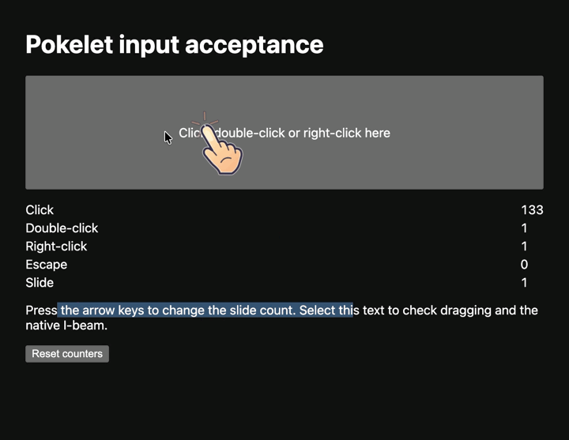
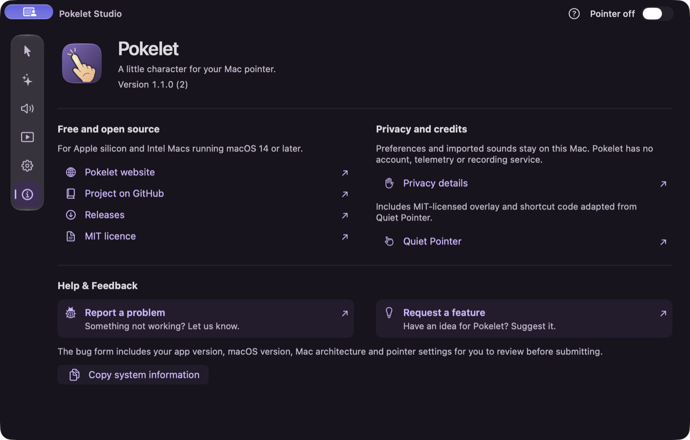

# Pokelet

**A cartoon companion for your Mac cursor.**

Pokelet is a free, open-source native macOS app that gives your pointer a personality. Choose a pointing finger, cat paw, foam finger or comic arrow, customise its appearance, and make every click a little more expressive.

[](https://github.com/smcnab1/pokelet/releases) [](https://github.com/smcnab1/pokelet/actions/workflows/macos.yml) [](https://scorecard.dev/viewer/?uri=github.com/smcnab1/pokelet) [](https://www.bestpractices.dev/projects/16999) [](LICENSE)

**macOS 14 or later · Apple silicon and Intel universal binary · No account or telemetry**

[Download the current beta](https://github.com/smcnab1/pokelet/releases/download/v1.1.0-beta.1/Pokelet-1.1.0-unnotarised.dmg) · [Release notes and SHA-256 checksum](https://github.com/smcnab1/pokelet/releases/tag/v1.1.0-beta.1) · [Website](https://smcnab1.github.io/pokelet/) · [Report an issue](https://github.com/smcnab1/pokelet/issues/new/choose)

> **Public download: Beta 1 (1.1.0).** Beta 2 (1.2.0, build 3) has passed owner acceptance but has **not yet been published**. The download above is deliberately still Beta 1. Public builds are ad hoc signed and not Apple-notarised.


<details>
<summary>Watch the pointer animation</summary>



</details>

## What it does

- **Four characters:** Finger, Cat Paw, Foam Finger and Comic Arrow, in original, white, black or custom colours, with adjustable size.
- **Three pointer behaviours:** Companion keeps the native pointer visible beside the character; Click-only shows the character when you click; replacement is limited to eligible areas inside Pokelet's own window.
- **Click reactions:** Five intensity settings, rapid-click effects and support for macOS Reduce Motion.
- **Optional sounds:** Built-in sounds or short imported local audio, muted by default.
- **Local by design:** Preferences and imported audio stay on your Mac. No tracking, accounts, network service or automatic updater.

**Coming in Beta 2:** Pokelet Studio, Presenter Arm, improved click alignment, Interactive clicks only sound playback, revised Dock and menu-bar behaviour, and a new default shortcut. These changes are already in the source but are **not** included in the Beta 1 download. See the [changelog](CHANGELOG.md) and [Studio guide](docs/STUDIO.md).

<details>
<summary>Preview the upcoming Pokelet Studio</summary>



</details>

## Install the current beta

1. [Download the Beta 1 DMG](https://github.com/smcnab1/pokelet/releases/download/v1.1.0-beta.1/Pokelet-1.1.0-unnotarised.dmg) and its [checksum file](https://github.com/smcnab1/pokelet/releases/download/v1.1.0-beta.1/Pokelet-1.1.0-unnotarised.dmg.sha256). In Downloads, verify them using:

   ```sh
   shasum -a 256 -c Pokelet-1.1.0-unnotarised.dmg.sha256
   ```

2. Open the DMG, drag **Pokelet** into **Applications**, then eject the disk image.
3. Open Pokelet from Applications. Because it is not Apple-notarised, macOS may prevent the first launch. If you trust the source and the checksum matches, go to **System Settings → Privacy & Security → Open Anyway** if offered, then confirm. **Never disable Gatekeeper globally. Stop if macOS reports malware or damage.** [Apple's guidance](https://support.apple.com/102445).
4. Choose **Enable Pointer** from Pokelet's hand-shaped menu-bar icon. The Beta 1 default keyboard shortcut is **Control–Option–P**.

For **upcoming Beta 2** builds with new or reset settings, the default shortcut becomes **Option–Command–P**. Existing users retain their saved shortcuts after upgrading. The current shortcut is shown in the app's General settings. Finder also uses Option–Command–P for the path bar, so Pokelet's shortcut can take precedence while it runs.

## Permissions, limitations and safety

The current public beta works with passive pointer observation and does not require Accessibility or Input Monitoring for ordinary use. In Beta 2, **Interactive clicks only** sounds use Accessibility information if access is available; without it, the app pauses that sound mode and offers Every click. No control text is stored or sent anywhere.

**Presentation Mode's click suppression is experimental and unavailable in public Release builds.** Its separate Debug acceptance process is documented in the [interactive acceptance guide](docs/INTERACTIVE_ACCEPTANCE.md).

Universal binaries target macOS 14 and later, but runtime testing on native Intel hardware and macOS 14 is incomplete. Multi-display, full VoiceOver and keyboard traversal, and some Accessibility-dependent interactions also have limited coverage. [Read the verification record](VERIFICATION.md).

For screen recordings, capture an entire display to include the overlay; window-only capture generally excludes it. Audio recording depends on your recording application's capture settings.

Read the [privacy policy](PRIVACY.md) and [security policy](SECURITY.md).

OpenSSF checks and Best Practices are independently maintained assessments. Badges show their current recorded results, not a guarantee of security or proof of Apple notarisation. See the [assessment evidence](docs/OPENSSF_ASSESSMENT.md) and [security policy](SECURITY.md).

## Settings and removal

Open Settings from the menu bar to choose your character, appearance, animations, audio and shortcut. The current source code includes the new [Studio interface](docs/STUDIO.md), which will ship in Beta 2.

To uninstall, optionally use **Reset Settings…** in General to clear imported audio, preferences and launch-at-login registration. Quit Pokelet, move it from Applications to the Bin and remove any optional grants in macOS Privacy & Security.

## Build from source

Install Xcode 16 or later with the macOS SDK and command-line tools. Open `Pokelet.xcodeproj`, select the `Pokelet` scheme and choose **Product → Run**. For command-line tests and a local, ad hoc-signed universal candidate:

```sh
./script/build_and_run.sh --build
swift test -Xswiftc -warnings-as-errors
./script/package_release.sh
```

Packaging writes an app, ZIP and checksum under `dist/candidate/`. It does not publish a release. See the [release checklist](docs/RELEASE_CHECKLIST.md).

## Contribute and acknowledgements

[Report a bug](https://github.com/smcnab1/pokelet/issues/new?template=bug.yml) · [Suggest a feature](https://github.com/smcnab1/pokelet/issues/new?template=feature.yml) · [Contribute](CONTRIBUTING.md) · [Report a vulnerability privately](SECURITY.md)

Pokelet is independent of Pokey and not affiliated with its developer. It adapts MIT-licensed Quiet Pointer code and uses original Pokelet artwork and sounds.

[MIT licence](LICENSE) · [Third-party notices](THIRD_PARTY_NOTICES.md) · [Changelog](CHANGELOG.md) · [OpenSSF evidence and progress](docs/OPENSSF_ASSESSMENT.md)

## Website

The landing page remembers its cursor preferences in your browser. It asks GitHub's public API for release metadata to resolve the download link and caches the response briefly in your browser tab. Click sounds start muted when you load the page.

See the [website development guide](docs/WEBSITE.md) to preview the landing page locally and run its browser checks. The website self-hosts the [Geist](https://github.com/vercel/geist-font) font under the [SIL Open Font License](docs/site/assets/geist-OFL.txt).
