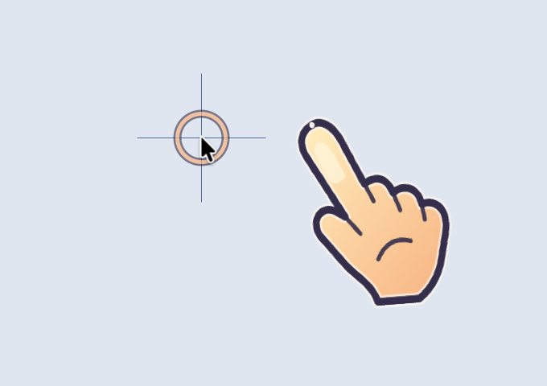
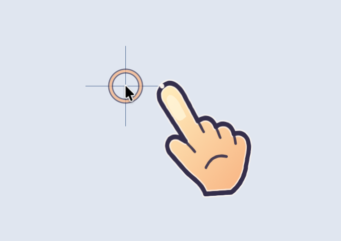
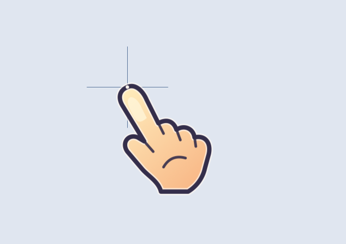
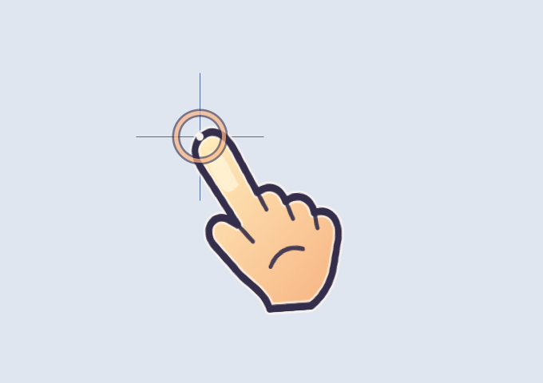

# Beta 2 acceptance

**21 November 2026 · NO-GO for release.** The local candidate passes pixel-based renderer checks and package qualification. Live Replace in Studio, physical click-to-fingertip alignment and the remaining desktop checks still need acceptance.

Testing continued on `fix/native-studio` from `7dc810c`. The pointer changes are in `c1d5212` and sound changes are in `c0b03ab`. The test Mac was an Apple M2 running macOS 27.3 and Xcode 27.2 with one 2× display. The live candidate had its own Debug bundle identifier and preference domain. The local Release package remains version 1.1.0 (2).

## Cursor and click effects

The original renderer used the same nominal artwork point for every character. It marked the beginning of the paths, which can sit inside the visible painted tip. Companion measured its gap from the square image canvas, including transparent space. Click-only used that same offset. The live overlay skipped ordinary local mouse-downs in Studio, and elsewhere it placed the character using the current cursor position while placing the effect using the earlier event coordinate. Effects already had separate positions, but artwork could cover them.

The mouse-down event now supplies the impact point in both the live overlay and Studio. Replacement eligibility follows the current native cursor, which may already have moved after the event. The renderer uses each illustration’s painted contact point as the rotation and scaling anchor. Companion stays beside the native arrow using the visible ink bounds, while Click-only reveals the character at the mouse-down point. The standalone preview uses the same placement and effect code. Impacts render above the artwork and keep their event positions when the character moves.

### Before and after

The crosshair marks the reference point in both columns. These PNGs capture actual Core Animation output in the disposable native fixture. The fixture uses the system arrow image to illustrate Companion and reproduces the baseline Studio click gate for Replace. It does not hide the system cursor.

| Mode | Baseline `7dc810c` | Candidate |
| --- | --- | --- |
| Companion, The Finger at 132 pt |  |  |
| Replace in Studio, The Finger at 132 pt |  |  |

### Rendered measurements

Coordinates are in AppKit fixture points. The primary reference is **(125.25, 154.25)** and the secondary reference is **(205.75, 165.75)**. The test samples the painted tip marker, the primary impact centre and the secondary ring bounds from presentation-frame pixels. Both effects are captured after a subsequent character move. The reference is a test coordinate supplied to the renderer.

| The Finger, 76 pt at 2× | Visible character hotspot | Primary impact | Secondary impact |
| --- | --- | --- | --- |
| Companion | (153.75, 154.25), 28.50 pt beside the click | (125.25, 154.25) | (205.75, 165.75) |
| Replace | (125.25, 154.25) | (125.25, 154.25) | (205.75, 165.75) |
| Click-only | (125.25, 154.25) | (125.25, 154.25) | (205.75, 165.75) |

The fixture covered **72 character cases** across The Finger, Cat Paw, Foam Finger and Comic Arrow, sizes of 44, 76 and 132 pt, 1× and 2× rasters, and all three modes. Maximum observed aligned tip error was **1.46 pt**, and maximum rendered impact error was **0.36 pt**. Companion's maximum error against its intended offset was **1.41 pt**. The fixture also captured the Presenter Arm outline at the centre, all four edges and all four corners at each size, and measured rapid primary and secondary effects at each size. Presenter Arm outline proximity was within **0.36 pt** at all 27 positions.

Run `./script/test_pointer_visual.sh build/beta2-visual` on a Mac with an active desktop to generate the PNGs and measurements.

### Presenter Arm on the desktop

| Check | Observed result |
| --- | --- |
| Stationary glove | At 44, 76 and 132 pt the nearest opaque outline pixel was 0.47 pixels, or **0.24 pt**, from the sampled native pointer at AppKit **(1285.668, 571.027)**. These measurements cover the final artwork, including a repeat capture at 132 pt. |
| Primary and secondary effects in Studio | Desktop automation sent targeted mouse-downs to Studio. From the Studio window origin and the clicked offsets, the expected Quartz positions were **(961, 274.5)** and **(637, 407)**. The live overlay's primary centre and secondary ring centre matched both at the measured pixel resolution. These targeted clicks leave the physical cursor in place. |
| Ordinary input | The disposable AppKit fixture received primary and secondary mouse-downs and activated the enabled button twice on the rapid pair. For that pair AppKit delivered **(745, 749)** and Quartz reported **(745, 363)**. The desktop driver's targeted clicks establish event delivery to the fixture. |
| Lifecycle | The isolated candidate kept the same overlay when Studio was open, minimised and closed. A rebuilt candidate repeated the close and reopen check in the same process. Turning Presenter Arm off restored the prior character and Companion. Command–Q removed the overlay and process. |
| Rendering cost | The regression test confirms repeated placement at the same point reuses the sleeve path. In five one-second samples after the initial reading, the final Debug process had median CPU 0.0%, peak 5.0% and about 54 MiB of memory. This was a short stationary sample. Sustained movement cost and WindowServer cost remain unmeasured. |

[Live glove at 132 pt](screenshots/beta2/presenter-arm-live.png) · [Lower-right renderer capture](screenshots/beta2/presenter-arm-edge.png) · [Live primary impact crop](screenshots/beta2/presenter-primary-live.png) · [Live secondary impact crop](screenshots/beta2/presenter-secondary-live.png)

**BLOCKED** on an approved Replace in Studio trial with physical input. A physical click needs to establish the full chain from the system cursor through the illustrated contact point and impact to the control that receives the click. The full physical corner and edge sweep, movement performance and cursor restoration after actual hiding also remain open.

### Physical trial preflight · 21 November 2026

Built the exact `bb48c83` source from a Git archive using isolated Derived Data and the Debug bundle identifier `uk.co.sammcnab.Pokelet.PhysicalBeta2`. The strict signature check passed. The staged process was PID 85074. Its executable SHA-256 was `cdf44a554f40c244c3c5c04ffeda3543c73c18ca8bf405ec4d23abc971fa38af`. The Debug code dylib SHA-256 was `c8f510cc794b529a0b13db599cd0d5d159361a2da6f00d12787e26d37eac6346`.

| Check | Result |
| --- | --- |
| Starting state | Studio reported **Enable pointer** off. The fresh profile had no saved values and started at The Finger, 76 pt, in Companion, with restore-on-launch off. WindowServer showed Studio and zero candidate overlay windows. The existing preference domain was read separately. |
| Target and recovery | Studio exposed the 29 × 27 pt preview background button at Quartz **(947, 261)**. It changes the preview background on activation. A separate AppKit fixture exposed nine labelled targets and records button actions with event coordinates. General displayed **Option–Command–P** for toggling the pointer. The recovery Terminal was open and its dry run verified the candidate PID, executable path and start time. |
| Physical baseline | The owner approved the isolated Replace trial. With the pointer off, the first mouse-down landed just above the Centre button at Quartz **(862.359, 409.695)** and the counter stayed at zero. The next on-target click activated Centre at **(860.730, 431.203)**. Both the mouse observer and the fixture logged that position. The owner confirmed the native arrow and counter increment. |
| Live trial setup | The isolated process enabled Replace with The Finger at 76 pt. WindowServer showed one click-through overlay. After the Studio window moved, the preview background button occupied Quartz **(605, 409, 29, 27)**. |
| Safe desktop checks | With the pointer off, accessibility actions opened General and Presentation and closed Studio. Launch Services reopened Studio in the same PID. The status menu was unavailable through accessibility, and the physical Dock and status menu checks remain open. Presentation displayed **Unavailable in this build**. |
| Interactive sound classifier | A separate probe built from `bb48c83` classified the fixture's Centre button as interactive and its heading, counter and blank areas as non-interactive. The button callback completed in 23 ms. Acoustic playback remains open. |
| Fresh automated and package checks | 46 SwiftPM tests passed on arm64 and 46 on x86_64 under Rosetta. Debug build and analysis, native Studio layout, renderer captures, universal Release package and analysis, ZIP verification and mounted DMG bundle smoke passed. The Release package checks found no Debug acceptance flags or debug entitlement in either slice. The Release source still disables Presentation Mode. |

Local evidence is under `build/beta2-physical.blAphB/evidence/`. Physical compatibility on additional displays, display scales, Intel hardware and macOS 14 remains **BLOCKED** on available hardware or OS. The system reported Reduce Motion, Reduce Transparency and VoiceOver off. Checks that need those settings changed remain **BLOCKED** pending separate approval.

### Live physical sample · The Finger at 76 pt

The owner reported that replacement worked inside Studio and that the illustration shifted near the title bar and when Codex was in front. Studio replacement is limited to exposed content in the active window. At the boundary, the character moves to its Companion position next to the native arrow. The Studio description says “inside this window”, so it leaves the title-bar boundary implicit.

| Physical check | Observed result |
| --- | --- |
| Fingertip | Two stationary captures over the preview background button put the painted tip within **0.27 pt** and **0.38 pt** of the sampled Quartz cursor at **(617.012, 416.133)** and **(616.742, 424.215)**. Both were captured at 2×. |
| Target delivery | Two physical primary clicks reached the preview background button at **(616.742, 424.215)**. Captures showed the preview change from dark to light and back. The fixture baseline miss was outside the painted button. |
| Title bar and primary effect | During the top-bar pass, the impact at **(669.012, 330.023)** was centred at **(669.000, 330.000)**. The character tip was about **31 pt** to the right. Another upper-window impact at **(838.410, 59.539)** was centred within **0.10 pt**, with the tip about **31 pt** to the right. These offsets match the Companion placement for this character and size. An AppKit window with the same titled style excluded a 32 pt top strip from its eligible content rectangle. |
| Rapid click and movement | The observer captured a three-click burst with mouse-down intervals of **201 ms** and **165 ms**. Movement arrived **16 ms** after the first down. The captured overlays showed primary effects during the burst. |
| Secondary, modes and restoration | No physical secondary click was recorded in this sample. Click-only, the remaining character and size cases, the complete edge and corner sweep, and post-hide recovery are still open. |

## Sound, menu bar and feedback

| Area | Result |
| --- | --- |
| Interactive click sounds | **PASS for the fallback and scoped classifier.** When access is unavailable, Studio explains that interactive sounds are paused and offers **Use Every click**. Preview and existing sound preferences remain available. The previous system-wide AX query returned Vorssaint elements through the disposable fixture. The classifier now queries the mouse event’s receiving process and leaves clicks silent when the target or control is unavailable. |
| Native Accessibility | With existing access in the test harness, the actual enabled button and editable field classified as interactive. The disabled button, static label and blank area did not. TextEdit’s editable document classified as interactive and its title-bar background did not. Fixture requests took 0.11–0.15 ms to enqueue and 1.25–25.71 ms to complete asynchronously. **BLOCKED** on end-to-end interactive playback permission in the isolated app and on an acoustic check. No permission prompt was requested. |
| Menu bar and Dock | **PASS for the fallback.** Thaw and Vorssaint were running. The closed final candidate retained regular activation with no visible status item frame. Launch Services reopened Studio in the same process, and Command–Q provided an accessible exit. `NSStatusItem` lifecycle code is unchanged. A fresh native status-menu check with those utilities paused is **BLOCKED** in this trial. [Earlier unobstructed menu evidence](LIVE_ACCEPTANCE.md#menu-bar-and-dock-follow-up--21-november-2026) |
| GitHub issue forms | **PASS for local readiness.** Both form schemas, public/private routing, labels, encoded prefill and diagnostic-copy tests passed. Public `main` at `1c07754` still has `bug.yml` and `feature.yml`. The new form filenames and field identifiers are already on the local branch. Publish them through the normal PR after approval, then verify prefill in the public chooser without submitting an issue. [Public issue templates](https://github.com/smcnab1/pokelet/tree/main/.github/ISSUE_TEMPLATE) |

## Verification and release blockers

| Check | Result |
| --- | --- |
| Core tests and source | **PASS** · 46 SwiftPM tests on Apple silicon with warnings as errors and 46 XCTest cases in the x86_64 test bundle under Rosetta. The default SwiftPM cross-architecture runner attempted to load the x86_64 bundle in an arm64 helper. Running the bundle with x86_64 XCTest resolved it. Shell syntax, documentation links, issue-form validation and diff whitespace checks passed. |
| Build and package | **PASS** · Debug build and analysis, native Studio layout in both widths, appearances and text sizes, universal Release build and analysis, ZIP integrity and strict bundle signature, and mounted DMG layout with embedded bundle smoke. Both slices declare macOS 14.0. |
| Presentation Mode | **PASS** · ordinary Debug displayed **Unavailable in this build**. The Release build disables Presentation Mode, and packaging checks both slices for Debug launch flags and debug entitlements. |
| Existing settings | **PASS** · Core tests load earlier settings and preserve existing values. The disposable native candidate retained the selected character and size across relaunch. |
| Keyboard and VoiceOver | **PARTIAL** · Studio shortcut navigation, close, reopen and quit were exercised. Controls and labels were exposed in the AX tree. Full keyboard focus traversal and spoken VoiceOver output are **BLOCKED**. |
| Accessibility display settings and physical audio | **BLOCKED** · composed reduced-motion effects and sound resource decoding passed. The host’s system Reduce Motion and Reduce Transparency were off. A system-level visual pass with both settings enabled, acoustic playback and physical output switching remain open. |
| Display and runtime | **BLOCKED** · physical display scaling changes, cross-display movement, macOS 14 runtime and Intel hardware were unavailable for this run. The 1× renderer and x86_64 Rosetta results cover the raster and translated code paths respectively. |
| Publication | **BLOCKED** · the package is local and ad hoc signed. Trusted distribution, release version approval, final GitHub publication and a quarantined install or upgrade are pending. |

No upload, push, merge, release, version change, permission change or installed-app replacement was performed. The earlier running Pokelet copy and both menu-bar utilities were left in place.
